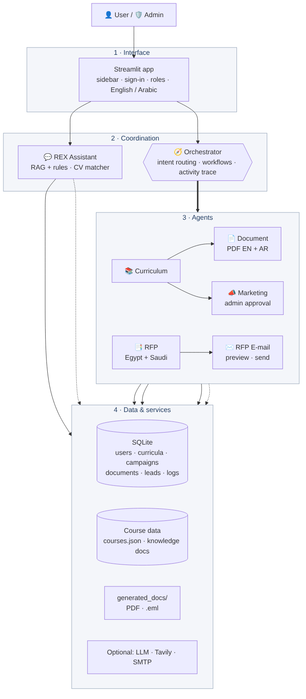

# REX AI – Smart Academy

A multi-agent system for a training academy. A chatbot advises learners, and an **Orchestrator** coordinates
specialised agents that design curricula, produce English/Arabic PDFs, prepare marketing campaigns and
watch for training tenders in Egypt and Saudi Arabia.



## What it does

| Part | What it does |
|---|---|
| 💬 **REX Assistant** | Answers from real course data (prices, duration, careers), recommends courses, English + Arabic. **CV match:** upload a CV (.pdf/.docx/.txt) or describe your background to get the best-fitting courses. |
| 🧭 **Orchestrator** | Understands a request (“Launch the Excel course”), calls the right agents in order, passes results between them, and pauses for human approval. Every agent call is shown in an **activity timeline**. |
| 📚 **Curriculum Agent** | Generates a structured curriculum, supports review → revise → approve with versions, gap analysis against accreditation requirements (never claims official accreditation). |
| 📄 **Document Agent** | Produces downloadable PDFs in **English and Arabic** (right-to-left, joined letters): curriculum report, course description, gap analysis. |
| 📣 **Marketing Agent** | Creates campaign content for 7 channels in English/Arabic, a 7-day plan and KPIs. Needs **admin approval**; nothing is ever auto-published. |
| 📑 **RFP Agent** | Finds/processes tender opportunities, **keeps only Egypt and Saudi Arabia**, drops expired and duplicate items, summarises each. |
| ✉️ **RFP E-mail Agent** | Builds a digest, shows a preview, and sends it to chosen recipients by SMTP (or saves an `.eml` file when SMTP is not configured). |
| 🏠 **Dashboard** | Counts and charts from the database (curricula, documents, campaigns, leads, agent calls). |
| 🔐 **Accounts** | Sign-up / sign-in, roles **user** and **admin**, saved profile and chat history, lock-out after repeated wrong passwords. |

## Quick start

```bash
git clone https://github.com/mowaleed77/rex-ai.git
cd rex-ai
python -m venv .venv
.venv\Scripts\activate          # Windows   (Linux/macOS: source .venv/bin/activate)
pip install -r requirements.txt
copy .env.example .env          # Linux/macOS: cp .env.example .env   - then edit if needed
streamlit run apps/agents_ui.py
```

Open http://localhost:8501 and sign in as **admin** (password from `.env`, default `Admin@12345` – you are
asked to change it at first sign-in). Create a normal account from the *Create account* tab to see the user view.

The app works **without any API key** (rule-based mode). Optional settings in `.env`:

| Setting | Effect |
|---|---|
| `LLM_API_KEY`, `LLM_BASE_URL`, `LLM_MODEL` | AI-generated content and RAG answers (any OpenAI-compatible API) |
| `TAVILY_API_KEY` | Live tender discovery for the RFP agent |
| `SMTP_HOST`, `SMTP_FROM`, … | Really send the RFP e-mail digest |
| `REX_ADMIN_PASSWORD` | Choose the first admin password |

## Who can see what

| Section | User | Admin |
|---|:-:|:-:|
| Dashboard, Assistant (+ CV match), Command Center, Curriculum, Documents, My Profile | ✅ | ✅ |
| Marketing (campaign review), RFP Research (+ e-mail), Admin panel | – | ✅ |

## Try the multi-agent workflow

1. Open **Command Center** and click *Launch the Excel for Business Analysis course*.
2. Watch the **agent activity timeline**: Orchestrator → Curriculum Agent → Document Agent.
3. As admin, approve the curriculum; the workflow continues with the PDFs and a marketing campaign
   that waits for admin approval.
4. Download the PDFs (switch the language to Arabic to see right-to-left output).

## Tests

```bash
pytest -q
```

Covers every agent, the orchestrator workflows, authentication and storage, Arabic PDF rendering,
the RFP country filter and e-mail digest, the CV matcher, the timeline and the dashboard statistics.
Some tests need `data/courses.json` and the knowledge documents in `data/rag_docs/`.

## Project structure

```
apps/            Streamlit UI (agents_ui.py) and styling (ui_theme.py)
rex/agents/      curriculum, document, marketing, rfp, rfp_email, orchestrator
rex/assistant/   chatbot (rule-based engine + RAG)
rex/core/        SQLite database, authentication, storage, dashboard statistics
rex/utils/       Arabic PDF text shaping, catalog access, CV matcher, activity timeline
rex/rag/         retriever and LLM client
data/            course catalog and knowledge documents
tests/           automated tests
docs/            architecture diagram, coverage table, upgrade notes
tools/backup.py  copies files to backups/ before they are modified
```

## Known limitations

- The Document Agent supports 3 document types (the brief requires at least 3).
- With an LLM configured, the chatbot does not run the “may admissions contact you?” consent flow.
- The REST API (`rex/api.py`) has no authentication; the Streamlit app is the supported interface.
- The CV matcher is keyword-based; it suggests courses, it is not a hiring assessment.

## Team

Fill in the two team members, their GitHub accounts and what each one built (the brief asks for a
contribution summary).
