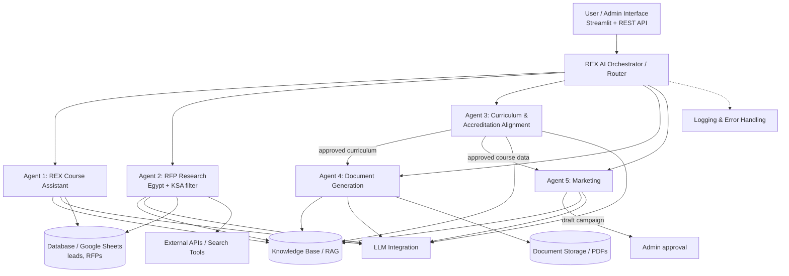

# System Architecture



## Components
| Component | Sprint 1 implementation | Planned |
|---|---|---|
| Interface | Streamlit app, CLI, FastAPI `/chat` | Unified admin UI (Sprint 3) |
| Orchestrator | `rex/agents/orchestrator.py` — registry + dispatch + error capture | Multi-agent workflows |
| Agent interface | `rex/agents/base.py` — `Agent.run(task) -> AgentResult(output, message, sources)` | — |
| Knowledge base | JSON files in `data/` with source + update date per record | Chroma/FAISS embeddings |
| LLM | Not required for baseline | OpenAI-compatible API (Sprint 2) |
| Storage | CSV for leads | SQLite / Google Sheets for RFPs |

## Data contract between agents
Every agent returns `AgentResult` so outputs are reusable and **traceable** (`sources` list):
```
AgentResult(agent: str, ok: bool, output: dict, message: str, sources: list[str])
```
Planned connected workflow (acceptance criterion): **Curriculum approved → Marketing generates campaign → Admin approves**.
